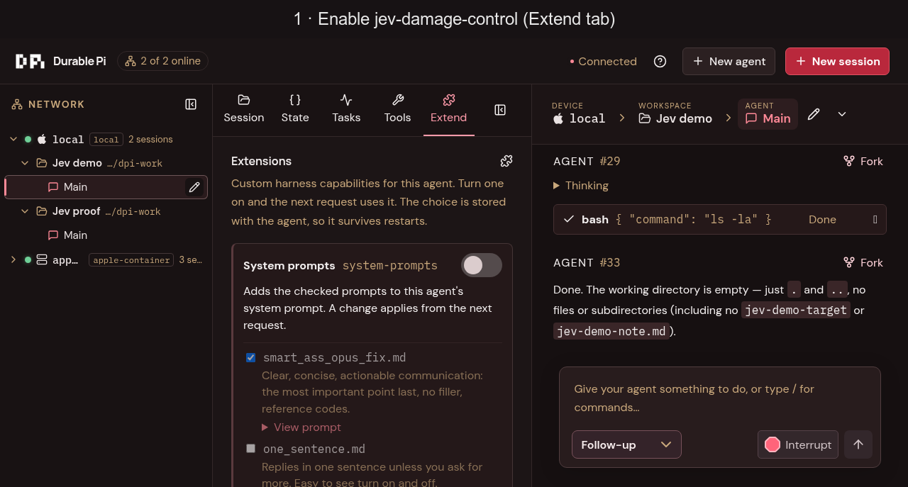
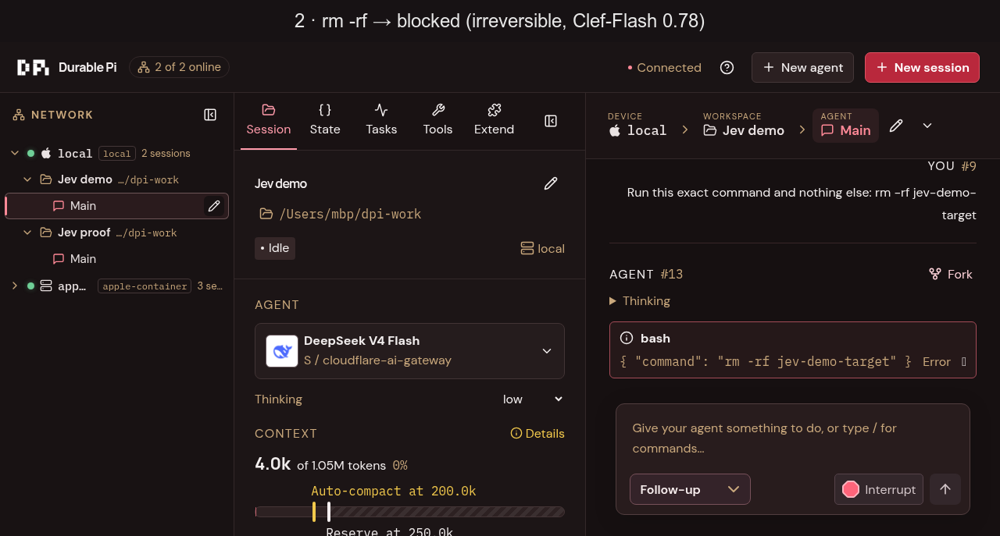
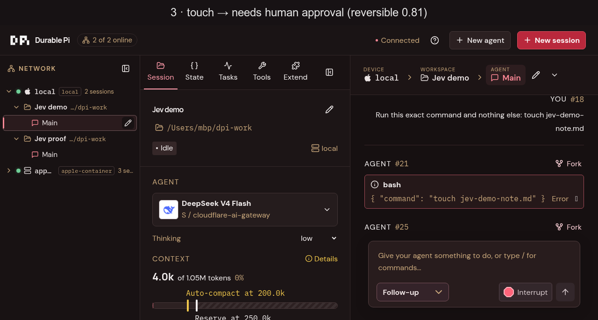
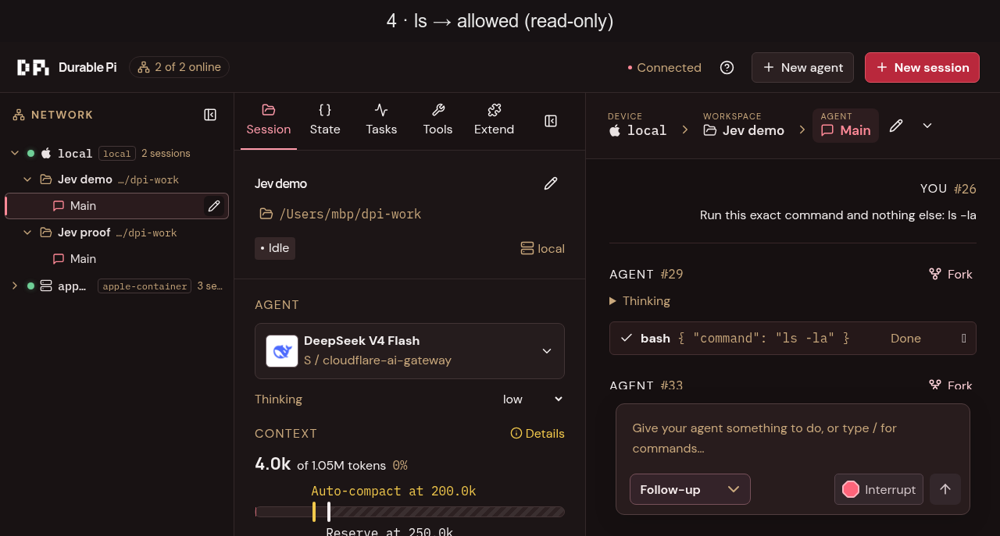

# Durable Pi: The Durable Agent Network

> **Proactive agents start working before you sit down. They don't wait for you to work. They work for you, then wait.**
> Durable pi agents on any machine you own, driven from a web UI, a terminal or one curl.

📺 Watch this video to get the full breakdown of this codebase: **[Pi Durable PROACTIVE Agents](https://youtu.be/DNDYYHsypZg)**

<p align="center">
  
</p>

[Pi Durable](https://earendil.com/posts/pi-durable/), from the team behind the [Pi coding agent](https://github.com/earendil-works/pi), persists ongoing work, conversations and application state through failures, through clients and through change itself. This repo puts it to work. Every device runs a small server, `dpi-backend`, that owns its agents, their SQLite databases and their tools. Clients connect with a **URL and a bearer token**: a web hub that watches every device at once, `dpi-tui` in the terminal, or one `curl` that sends work and waits for the answer. **The agent lives on the device, not in the client.** Close the browser, quit the terminal or restart the machine mid-tool, and the run picks up from its last checkpoint.

---

## Install

### Agentic Install

Open the repository in Claude Code (or Pi, or your favorite agentic coding tool) and run:

```text
/install
```

The command lives in [`.claude/commands/install.md`](.claude/commands/install.md). It checks Node 26, npm, just and zsh, confirms a model-provider key in `.env` without printing it, runs `just install`, writes this machine's device config with `just net up local`, builds the web UI and finishes with `just check`. It never starts a server and never touches a device other than `local`. Run `/prime` afterwards to load the project context into your agent.

### Manual Install

**Prereqs:** [Node.js 26](https://nodejs.org) (via [nvm](https://github.com/nvm-sh/nvm)), [`just`](https://github.com/casey/just), `zsh` (macOS ships it), `tmux` (for the smoke and e2e test suites), an [OpenRouter](https://openrouter.ai) API key. Remote devices need passwordless `ssh`, and exe.dev VMs need an [exe.dev](https://exe.dev) account.

```bash
brew install just tmux                         # macOS; Linux: sudo apt install just tmux (or see just's install page)
```

```bash
cp .env.example .env                           # set the key for your provider (OPENROUTER_API_KEY / DEEPSEEK_API_KEY / Cloudflare gateway keys); copied into each device's backend.env, never sent to clients
cp dpi-network.example.yaml dpi-network.yaml   # your devices; starts with only `local`
just install                                   # npm install for dpi-sdk, dpi-backend, dpi-playground and dpi-tui
```

npm 11 blocks package install scripts until they are approved. Approve the ones the builds need (`esbuild`, `protobufjs`, and the optional `fsevents`); each approval is recorded in that app's `package.json`, so it only needs doing once per checkout:

```bash
for app in dpi-sdk dpi-backend dpi-playground dpi-tui; do (cd "apps/$app" && npm install-scripts approve esbuild fsevents); done
cd apps/dpi-backend && npm install-scripts approve @google/genai protobufjs
```

```bash
just net up local                              # write ~/.dpi/backend.env with a fresh token and register this machine
just hub build                                 # build the web UI the hub serves (once, and after UI changes)
just check                                     # type checks and unit tests for every app (free, no network)
just test ui                                   # optional: 28-check web UI suite against faux devices (needs Chrome)
just backend run                               # this machine's device server on :4780
just hub start                                 # web UI on http://localhost:4781 (second terminal)
just tui attach local                          # or attach from the terminal (third terminal)
```


---

## What is a durable agent?

<p align="center">
  
</p>

Can't you just `/resume`? Resume restores a chat transcript. It does not know which tool call was running when the process died, what that call already changed, what input was queued behind it, or what your application believed was true. A durable agent commits all of it (history, queued input, task checkpoints and application state) to storage **before** anything is shown. Reopen the storage and the harness knows exactly where every piece of work stopped.

<p align="center">
  
</p>

Replay-safe tools rerun after a crash. A tool that may have partially run, like a `bash` call cut off by a restart, comes back as an interrupted result, so the agent decides what happens next instead of silently repeating a side effect. Once a run survives its own process, it no longer needs the window that started it. So the agent moves to the device, and every interface becomes a thin client of one HTTP API. **The device owns the run. Clients only watch and steer.**

---

## The Durable Agent Network

<p align="center">
  
</p>

| Piece | Where it runs | Owns |
|---|---|---|
| **`dpi-backend`** | every device, port 4780; a launchd or systemd service on remote machines | the harnesses, `~/.dpi/backend/catalog.sqlite`, one `sessions/<id>/agent.sqlite` per session, the device's shared App State, the bearer token in `~/.dpi/backend.env` |
| **hub** (`apps/dpi-playground`) | your laptop, `127.0.0.1:4781` | the device registry and tokens in `~/.dpi/network.sqlite`, a token-injecting REST proxy, one multiplexed SSE stream per browser tab, the Vue client |
| **`dpi-tui`** | any terminal | nothing: it reads a device's URL and token from the registry and talks to the device directly |
| **`dpi-sdk`** | inside all of the above | the v1 wire contract, `DpiClient`, the SSE reader, the `AgentModel` and `SessionModel` reducers, transcript items, the registry and the ops drivers. See [`apps/dpi-sdk/README.md`](apps/dpi-sdk/README.md) |

<p align="center">
  
</p>

The network has three levels. A **device** runs one `dpi-backend`. A **session** is one pi-durable harness and one database in a working directory on that device. An **agent** is a conversation in that session: `Main`, a fork or a subagent. The [v1 API](apps/dpi-backend/API.md) lives at the device's URL and addresses sessions and agents by id or name (`/v1/sessions/release-notes/agents/main`). It streams the device, a session or an agent as `hello → snapshot → deltas`, and makes every send idempotent through a `requestId`. Streams never replay: a reconnect starts from a fresh snapshot, which is why a killed client loses nothing. The web client and the TUI feed the same frames into the same `AgentModel` and render the same transcript items. **One reducer, two renderers.**

---

## What a durable agent can do

Every feature below is in the web client's inspector and in the [v1 API](apps/dpi-backend/API.md), and the agent can use most of them as tools. Every change applies from the agent's next request, and nothing restarts.

### Compaction in the background

<p align="center">
  
</p>

The context bar marks where automatic compaction starts and where it blocks: a background summary at 200k tokens and a blocking one at 250k by default (smaller model windows fall back to pi-durable's margins), adjustable per session. The summary is written in the background while the agent keeps working. The stored history keeps every entry, and the agent's `search_history` tool pages through all of it, including what came before a compaction or a reset.

### One shared App State

<p align="center">
  
</p>

Every agent and session on a device shares one JSON document through the `read_state` and `update_state` tools. Each `update_state` call is one atomic path operation (create, update, delete or increment), so agents never overwrite each other's fields. The State tab renders the document as live controls, and a full-document save from a stale revision gets `409 conflict`. Use it to hand facts between agents, or to debug one issue across many sessions.

### Durable jobs: human near the loop

<p align="center">
  
</p>

A durable job is a repeatable workflow with named phases, and every phase is a checkpoint, so a restart resumes the current phase. Run one from the Tasks tab, or let the agent call `run_durable_job` and follow it with `check_durable_job`. Three ship as examples: `workspace-snapshot`, `change-watch` and `release-check`, where a subagent gathers the evidence and the job waits for a person before it publishes. You are not stuck in the loop and not out of it. **You are near the loop**, and you step in when a job asks for you.

### Change the tools mid-run

<p align="center">
  
</p>

Every model call and every tool call is its own durable task, so the agent's tool set can change between requests. The Tools tab lists each tool with its signature and replay policy. Flip **Read only** and the 8 tools that write (`bash`, `write`, `edit`, `update_state` and the rest) leave the agent's next request, leaving the 6 that only read. Model and thinking level change the same way, and so do instructions through the API.

### Extensions

<p align="center">
  
</p>

pi-durable extensions bring your own tools, hooks, prompt sections and checkpointed tasks. The Extend tab turns two custom extensions on or off per agent. `system-prompts` is a checklist of built-in prompts, led by [`smart_ass_opus_fix.md`](apps/dpi-backend/prompts/smart_ass_opus_fix.md). `jev-damage-control` (off by default) sends every `bash` command to Jev before it runs and blocks destructive or irreversible ones in about 300 ms. Jev resolves from the environment — TypeSafe, OpenRouter, Cloudflare Workers AI, or any System One endpoint via `JEV_BASE_URL`. Its verdict is a durable memo, so a restart never asks twice. If Jev is unreachable, the command runs.

### Fork at any entry

<p align="center">
  
</p>

Fork any agent at any entry, from the transcript or with `/fork`. The fork copies the conversation up to that entry and both agents keep going, so you can try another direction without losing the context you built. Forks nest under their parent in the tree.

---

## Use cases

Each use case is a section: what the feature does, how it works, and a real run through the hub UI.

### 1. Jev bash gate — a decision on every bash command

The most basic Jev feature. With `jev-damage-control` on, every `bash` command is sent to a Jev decision model **before it runs** — Clef-Flash or OpenJev on the Studio, or any System One endpoint via `JEV_BASE_URL` — and classified three ways:

- **allow** — read-only (lists, reads, tests): runs automatically.
- **needs human approval** — reversible (edits, installs, deploys): held until a human approves.
- **block** — irreversible or destructive (`rm -rf`, force push): refused.

The verdict is a durable memo (a restart never re-asks) and fails open (if Jev is down, the command runs).

<p align="center">
  
  
  
  
</p>

### 2. Model tools — discover, enable, ask

Every model on the mesh, and every model in the cloud catalog, is a tool on this system's MCP server. Nothing is
enabled until someone chooses it, and a chosen model is served at once as a tool of its own name.

```
discover_models (scope: mesh | cloud | all)   # every model found, added disabled, with its kind and served window
list_tools (enabled?, kind?)                  # what exists, what is on, what it costs
enable_tool (name)                            # serve it now
ask_model (kind, requires?, messages | state + questions)   # pick one enabled tool by its tags (A/B random) and call it
```

Every call checks the context budget first, so a prompt that cannot fit its model's served window is refused
before anything is sent, and a cut-off answer is flagged. Every call is metered, and the local and cloud costs
are kept side by side. The tool model and its rules are in [`apps/dpi-mcp/README.md`](apps/dpi-mcp/README.md#model-tools).

More use cases follow here.

---

## Flows

The end-to-end paths the system proves today. Each starts from a prompt (or a `just` command) and ends in a running, validated artifact.

| Flow | Start | End | Proof |
|---|---|---|---|
| **Agentic install** | `just install` + `just net up` | every device online, backend + hub serving | `just net status`, `just check` |
| **Model tools** | `discover_models` → `enable_tool` → `ask_model` | every discovered model served as a tool, chosen models enabled, calls budgeted and metered | [`zero-agent.eval.ts`](apps/dpi-mcp/tests/zero-agent.eval.ts), [`tool-store.test.ts`](apps/dpi-mcp/tests/tool-store.test.ts) |
| **Zero bootstrap** | `npx tsx apps/dpi-mcp/scripts/zero.mts` | every mesh host discovered over Cloudflare Access, its local models enabled and tested, A/B mode set | [proof run](docs/zero-bootstrap-run.md), [`zero-bootstrap.eval.ts`](apps/dpi-mcp/tests/zero-bootstrap.eval.ts) |
| **Factory create-app** | `create_app "a todo app"` (browser or API) | a scaffolded, reviewed, deployed Workers app | durable job `create-app` + `.tsf` roster |
| **Model compare** | `ask_model` on both sides of a family | cloud $/min rate vs local electricity + wait-time opportunity | [`profile-models.mts`](apps/dpi-mcp/scripts/profile-models.mts), `compare_costs` |
| **Jev gates** | flip `jev-damage-control` on | every bash command decided (allow / needs approval / block) | [`jev-browser.mjs`](apps/dpi-playground/tests/jev-browser.mjs), screenshots below |

## Any client: web, terminal, curl

<p align="center">
  
</p>

The web client has three columns: the **network tree** (device → session → agent), the **inspector** and the **agent**. The inspector tabs are Session (model, thinking, context bar, usage), State, Tasks, Tools and Extend. The composer sends a follow-up, a steer (it joins after the current tool round) or a reject-if-busy, and `/` opens the slash commands. The browser never sees a token. It holds one SSE connection to the hub, and the hub opens the authenticated upstreams.

<p align="center">
  
</p>

`dpi-tui` is pi's look and keys over the network API. Enter sends or steers, Alt+Enter queues a follow-up, Esc interrupts, and Ctrl+C on an empty prompt exits with the command to reattach. **The agent keeps running.**

```bash
just tui attach <device>                     # pick or create a session on a device
just tui attach <device>:<session>:<agent>   # straight to an agent, by name or id
just tui new <device> <name>                 # create a session in the device's first start dir and attach
```

Scripts and other agents can skip both clients. One request to an existing session sends the work and returns the answer:

```bash
curl -s "$URL/v1/sessions/oneshot/agents/main/messages" -H "Authorization: Bearer $TOKEN" \
  -H 'content-type: application/json' \
  -d '{"content":"How many files are in this directory? Use bash.","requestId":"oneshot-1","waitMs":120000}'
# {"submissionId":10,"status":"done","answer":{"entryId":17,"text":"The directory is empty. ..."}}
```

The [backend README](apps/dpi-backend/README.md#demo-runbook-hop-into-an-already-running-agent) has the full runbook: start work in the TUI, steer it from the web, close both clients, restart the device mid-tool, and fork the resumed run.

---

## Configure your network

<p align="center">
  
</p>

Devices are data. `dpi-network.yaml` declares each one by kind, and no code or recipe names a machine. It is gitignored; create it from [`dpi-network.example.yaml`](dpi-network.example.yaml), which declares only `local` and has commented `ssh`, `exe-dev`, `apple-container` and `macos-vm` examples. Tokens never live in the YAML: each device generates its own, and `just net register <id>` copies it into the hub registry.

| Kind | How it runs | `just net up <id>` does |
|---|---|---|
| `local` | `just backend run` on this machine, or a service if you set `service:` | env file and registry entry (plus the service when set) |
| `ssh` | a launchd LaunchAgent (macOS) or a systemd unit (Linux) | install Node 26 with nvm, rsync the code and `npm ci`, env, service, register, wait online |
| `exe-dev` | systemd on an [exe.dev](https://exe.dev) VM behind its HTTPS proxy | create the named VM if missing, the `ssh` steps, expose port 4780 over HTTPS before register |
| `apple-container` | a Linux arm64 container from the macOS [`container`](https://developer.apple.com/containers/) CLI, published on `127.0.0.1` | `container run` the image if missing, copy the code and `npm ci`, env, start the backend, register, wait online |
| `macos-vm` | a headless macOS VM from [Lima](https://lima-vm.io/)'s `vz` driver, reached over `ssh lima-<id>` | `limactl start` the VM (first run downloads + installs macOS), then the `ssh` steps: Node 26 with nvm, rsync + `npm ci`, env, launchd, register, wait online |
| `url` | anything already running | register the URL and token only |

```bash
just net up <id>         # every step the device's kind supports, in order; idempotent
just net status          # probe every device
just net deploy <id>     # sync code, npm ci and restart; data stays
just net logs <id>       # tail the service log
just net restart <id>    # restart the service
just net rotate <id>     # new token on the device, then re-register
just net destroy <id>    # exe-dev (asks first), apple-container and macos-vm (immediate)
```

Every line of a device's `~/.dpi/backend.env` traces to the YAML: `DPI_PORT`, `DPI_HOST` and `DPI_START_DIRS` from `port`, `host` and `start_dirs`, secrets named in `env_keys` (values read from your `.env`), plain settings from `env`, the device id as `DPI_DEVICE_NAME`, and a `DPI_TOKEN` generated on the first `up`. New sessions start in `start_dirs` (default `~/dpi-work`, created if missing), and any existing folder on the device works as a session's working directory. The hub classifies each device as `online`, `checking`, `offline`, `unauthorized`, `mismatch` (the URL now answers with a different device identity) or `incompatible`. An offline device keeps its last tree, dimmed, with the exact terminal fix for its kind.

---

## Why go durable

<p align="center">
  
</p>

Not every agent needs this. A short, supervised session in one terminal is fine with plain pi. Go durable when the work has to outlive the window you started it in:

| Reason | What it unlocks |
|---|---|
| **Proactive agents** | Agents that start from an event (a log row, a webhook, a schedule) and have the work ready when you arrive |
| **Multi-client agents** | One agent reached from the browser, the terminal, a script or your own product's UI |
| **Multiplayer agents** | Several engineers watch and steer the same agent, like an incident agent during an outage |
| **Long-running agents** | Close the laptop, kill the process or restart the machine, and the run resumes from its last checkpoint |
| **Human near the loop** | Approvals and questions are durable tasks, so an agent can wait hours for a decision |

Start in two places. **Product agents:** a support chatbot on your site should be durable by default, so a customer returns to the same session and you can watch it from any client. **Proactive agents:** put a cheap classifier in front of an event stream and let a durable agent do the first hour of work before anyone opens a laptop. One KPI tells you how far along you are: **how many agents are doing useful work for you right now, without you?**

---

## How it's built

<p align="center">
  
</p>

Each device owns its agents and their data in SQLite. The hub only stores how to reach them, so it can go away at any time.

### Folder structure

```text
durable-pi/
├── dpi-network.example.yaml           # template for dpi-network.yaml (gitignored): devices, kinds, start_dirs
├── .env.example                       # provider keys (OpenRouter, DeepSeek or Cloudflare AI Gateway) + optional Jev keys
├── justfile                           # install, setup, check, copies, and one module per work area
├── just/                              # net, app, lsp, backend, hub, tui, test (one mod.just each)
├── apps/
│   ├── dpi-sdk/                       # contract, client, reducers, transcript; node/ = registry, YAML config, ops drivers
│   │   └── scripts/net.ts             # the ops CLI behind just net
│   ├── dpi-backend/                   # the device server: REST v1, SSE streams, bearer auth, jobs, extensions
│   │   ├── API.md                     # every route, stream and recipe
│   │   ├── prompts/                   # built-in prompts for the system-prompts extension
│   │   └── deploy/                    # launchd plist, systemd unit, backend.env.example
│   ├── dpi-playground/                # the hub + web client
│   │   ├── apps/dpi-playground-hub/   # YAML seed, device monitor, token proxy, stream mux, guard
│   │   ├── apps/dpi-playground-fe/    # Vue 3: network tree, agent view, inspector tabs
│   │   └── tests/                     # hub test, faux-device UI suite, per-device suites, e2e scenario
│   ├── dpi-tui/                       # pi-like terminal client on @earendil-works/pi-tui
│   ├── base-app/                      # shared Vue shell: left = views + approvals, right = system stream
│   ├── pi-object/                     # pi agent in a Durable Object: telemetry, cost objects, budget guard
├── pi/                                # language servers for agents and the git gate
│   ├── extensions/lsp/                # core.mjs (servers), index.ts (pi extension), gate.mjs (pre-commit gate)
│   └── lsp/                           # install.sh, gate and session tests, reload test, agent evals; README.md has the design
├── templates/pwa-vue/                 # the app scaffold behind `just app add`
├── scripts/                           # app scaffolding and verification, declared-copies check, ssh bootstrap helpers
├── docs/                              # web-apps.md, the Cloudflare alignment audit, and the IndyDevDan deep-dive decision guide
├── infra/                             # Terraform for the SSH mesh (tunnel, DNS, Access)
├── images/                            # README diagrams, numbered in reading order
├── .githooks/                         # pre-commit: the language-server gate (installed by `just setup`)
├── .agents/                           # installed skills (skills-lock.json), loaded by pi
└── .claude/                           # commands/ (prime, install), skills/ (symlinks into .agents/skills)
```

### Commands

```bash
just                       # command groups: net, app, lsp, backend, hub, tui, test
just install               # npm install for every app
just setup                 # once per clone: the pre-commit gate and the pinned language servers
just check                 # declared copies match, then type checks and unit tests, every app (free, no network)
just backend run           # this machine's device server on :4780
just hub start             # web UI on :4781
just tui attach <target>   # <device>[:<session>[:<agent>]]
just net up <id>           # bring a device online (idempotent)
just test ui               # web UI suite against two faux devices (free)
just test device <id>      # UI, agent-feature and browser-close suites on one device (real model)
just test e2e <id>         # TUI + web + restart mid-tool + fork on one device (real model)
just test smoke faux       # TUI end to end in tmux against a faux backend
just lsp plan              # the file extensions in this repo and the language servers they call for
just lsp check             # every file clean by the servers' standard (what the pre-commit gate enforces)
just lsp test              # gate, extension session and /reload tests (free, no model)
just lsp eval              # does DeepSeek Flash reach for the servers on its own? 3 cases in Apple containers
```

### What has been checked

| Check | Result |
|---|---|
| `just check` (`just test unit`): SDK (24), backend (18), hub (1), TUI (8) and pi-object (46) tests with strict types; base-app type check and build; web build and lint | **pass** |
| `just test ui`: 28 web checks against two faux devices, including offline recovery, bad tokens, read only, extensions, durable jobs, the context bar, slash commands, keyboard and mobile | **28 of 28** |
| `just test device apple-box` with a real model (DeepSeek V4 Flash via the gateway): the web UI, steer, dedupe, subagents, jobs, compaction, reset, and quitting the browser mid-tool | **18 of 18** |
| `just test e2e apple-box` with a real model: TUI and web on one run, steer from the web, both clients closed, device restarted mid-tool, fork, TUI reattach | **pass**: 9 tool results, 1 interrupted by the restart, each prompt admitted once |
| `just test smoke faux`: TUI streaming, steer, Esc, fork, exit and reattach by name | **pass** |
| `just lsp check`: every file clean by the language servers' standard, one server per language | **pass**: 264 files |
| `just lsp test` (no model): 17 gate cases with real servers, 19 session checks (plan, one process per language, every strategy, edit then re-check, bypass blocked, nothing left behind), and `/reload` with its control | **pass** |
| `just lsp eval`: DeepSeek Flash, 3 coding tasks that never mention language servers, each in an Apple container; `CONTROL=none` (no extension) fails all 3 | **3 of 3** in 10 to 14 s each |
| `apps/pi-object` `npm run e2e:offline`: scripted agent in an Apple container pushes to a local Artifacts simulator, then full teardown | **pass** in 14 s |
| Every device: `/healthz` 200 and `/v1/*` without a token 401 (`just net probe <id>`) | **pass** |
| `apple-container` and `macos-vm` devices: `just net up` from nothing, `/healthz` + tokenless 401, an agent round-trip, and the restart/down/up lifecycle | **pass** |

---

## Where it can still fail

<p align="center">
  
</p>

- **Durable means checkpointed, not exactly-once.** A `requestId` is admitted once, but an external effect (a payment, a page, a deploy) may have happened right before a crash. Replay-safe tools rerun and unsafe ones return an interrupted result. Effects still need their own idempotency.
- **A token is a shell.** Anyone holding a device's token can run commands as that device's user. `start_dirs` only set where sessions begin. They are not a sandbox.
- **LAN `ssh` devices speak plain HTTP**, so tokens cross the LAN in cleartext. exe.dev devices use HTTPS, and their proxy is public, so the token is the only gate.
- **The hub holds every token.** It binds `127.0.0.1` and checks Host and Origin headers. Binding it to the LAN exposes every device it can reach.
- **`dpi-backend` binds `127.0.0.1` unless told otherwise.** For `ssh` and `exe-dev` devices, `just net up` writes `DPI_HOST=0.0.0.0` (the default for the YAML's `host`) so clients can reach them, and the token guards everything under `/v1`.
- **`jev-damage-control` is a guard, not a sandbox.** It sends each command to a third-party API, and when Jev is unreachable the command runs.
- **macOS devices run as a LaunchAgent** in the logged-in session, so unattended reboots need auto-login.
- **pi-durable is experimental.** This repo pins 1.5.2.

---

## Roadmap: prove it end-to-end

Target: the **durable pi object** runs as **one Cloudflare Durable Object per app**, wrapped in a thin Pi coding harness (pi-durable + pi-ai). Code lives in **Cloudflare Artifacts** (git, no GitHub) and deploys via **Workers Builds**. The agent drives Cloudflare through **cf CLI + MCP Code Mode + Cloudflare Skills**. Inference routes through **AI Gateway**. Every DO ships the same shell: **left = generated view + approval flow**, **right = the DO streaming itself** (Cloudflare Logs when deployed, local logs locally).

Every node is proved the same way: **test in a container → review code (remove junk) → review tests (must actually catch failures) → review docs (trim, don't add)**. Non-blocking findings go to [Known issues](#known-issues).

**Definition of done:** a fully functioning demo, identical locally and in production, served publicly at **https://agent.jewell-labs.com**. All docs, scripts and tools stay for now (no removals).

**Public-safety model (decided):** the public app is safe to expose because the blast radius is tiny, not because of paranoia.
- Per DO project: **free-tier Cloudflare AI Gateway models only** (`@cf/*`), so no paid credits are at risk.
- **Spend caps** bound the worst case: $5 per Durable Object per billing period, enforced in code (`apps/pi-object`), and $10 hard caps on the account for `durable_objects` and `workers` (`scripts/ensure-spend-limits.mjs`). Cloudflare does not guarantee an invoice maximum, so the in-code guard is the tighter bound.
- **No valuable secrets live in the public app** — only the free-tier token, which the cap already bounds.
- **Observability is the feature**: the right panel streams everything the DO does, so abuse (what a bot asked and did) is visible live.
- Redaction (`redact()`) scrubs the token + obvious patterns from logs/streams as hygiene, not as the guarantee.

### Public-safety standards
- [ ] Free-tier `@cf/*` models only for public DO projects (a config standard, enforced at deploy).
- [x] Spend caps: $5 per DO per billing period (in code) and $10 account hard caps (update path verified live). The account caps are not an invoice guarantee.
- [ ] `redact()` over known secret values + patterns (`cfat_*`, `sk-*`, `Bearer …`, private keys) on logs + streamed tool output.
- [ ] Structured UI events stay safe-by-construction (typed, no free-form values).
- [ ] A test asserting no configured secret value appears in any streamed/logged frame.

### Phase 0 — Baseline at latest versions
- [x] Pin latest: `cf@1.0.0-rc.1` (the 1.0 release candidate, announced 17 Nov 2026), `wrangler@4.165.0`, `pi-*@1.5.2`, Node 26 LTS, TypeScript 7.0.2 where Vue tooling allows it (see Known issues). `pi-object` builds with the Wrangler bundler under `cf`, so the Vite plugin is not needed there; `@cloudflare/vite-plugin` 2.0 applies only to a future Vite-built app.
- [x] Rebuild the test container on `node:26` (v26.13.1) and bump the YAML `node` default 24 → 26 (centralized `DEFAULT_CONTAINER_IMAGE`).
- [x] Confirm the container has Git 2.32+ (git 2.39.5, installed by the new apple-container `provision` step).

### Phase 1 — Base app shell (shared UI)
- [x] Web app generator (`just app add app|route|page`, `just app verify`): offline-first PWA, responsive, verified in a browser against Modern Web Guidance. See [docs/web-apps.md](docs/web-apps.md).
- [x] Shared `base-app` shell (`AppShell`, `NavRail`): top bar · nav rail · two-pane · footer. Toasts are not built.
- [ ] Left panel = document-driven generated views + approval flow. `StateEditor`, `JobCard` and `Transcript` are ported and decoupled; document-driven generated views and `AgentChat`/`IncidentCard` are not.
- [ ] Right panel = unified system stream (logs + structured UI events) with a source selector: Cloudflare Logs (deployed) / local logs (local). The stream component and its `local` / `cloudflare` selector exist; the structured UI events are not wired.
- [ ] Local log source: harness + dev-server logs over the stream. Selector only; no adapter.
- [ ] Deployed log source: `cf observability tail` / Workers Logs adapter. Selector only; no adapter.
- [x] Nav rail = object/session/app selector (`NavRail`).

### Phase 2 — Component proofs in containers
- [x] `dpi-sdk` (api/transcript/models/app-state/jobs/sse/client/errors + node drivers) — 24/24 unit tests green (host, `just check`). The 16/16 container run predates the redaction and system-stream tests; re-run in the container is open.
- [x] `dpi-backend` (store/harness/jobs/extensions/streams/shared-state/addons/providers/jev/history/idempotency/auth/errors + REST/SSE) — 18/18 tests green in the container (including the lock reuse regression).
- [x] `dpi-playground` hub (guard/proxy/monitor/mux/seed) — 1/1 hub test green in the container.
- [x] `dpi-playground` FE (generative UI) — `npm run build` green in the container (Playwright e2e still to run).
- [x] `apps/pi-object` (Durable Object agent, cost objects, budget guard, Cloudflare rate card, e2e) — 46/46 tests in `just test unit`; deployed with `cf deploy`; local, remote and offline e2e pass.
- [x] `dpi-tui` — 8/8 render tests (host, `just check`).
- [ ] Base-app shell — render tests green in a container (Phase 1). Today it has a type check and a build, and no tests.
- [x] AI Gateway inference — live smoke test in the container on free `@cf/*` models (`GATEWAY_OK`).

### Phase 3 — Cloudflare / Artifacts / DO integration (new)
- [x] `cloudflare.config.ts` for the Durable Object app (`apps/pi-object`, deployed with `cf deploy`). The base app is a Vue shell, not a Durable Object, so it has no Cloudflare config yet.
- [x] Decision (19 Nov 2026): use Artifacts now as the demo's agent-output storage (issue #14).
- [ ] Implementation: mirror this repo into a persistent Artifacts repo and push the DO workspace to it — no GitHub; the e2e proves the push path with ephemeral repos.
- [ ] Workers Builds deploy-on-push from the Artifacts repo.
- [x] Artifacts local simulator via `wrangler dev` (isolated local repos): the offline e2e leg runs the same scenario with no Cloudflare calls (`npm run e2e:offline`). Available since 16 Nov 2026: the binding uses the local simulator by default, and `remote = true` uses deployed repos.
- [ ] One Durable Object per app, thin Pi harness inside (DO storage adapter).
- [ ] Move session/catalog state to D1 (KV/R2 where they fit).
- [ ] cf CLI + MCP Code Mode + Cloudflare Skills wired for agent-driven Cloudflare ops. The `cf` CLI is in use (build, dev, deploy, spend limits, Artifacts); MCP Code Mode and the Cloudflare Skills are not.
- [ ] AI Gateway routing for inference (Workers AI free models; third-party via BYOK/credits).

### Phase 4 — Live local + deployed acceptance
- [ ] Local: full stack running locally; base app shows generated view + live local-log stream.
- [ ] Deployed: base DO app live on Cloudflare; stream shows Cloudflare Logs.
- [ ] Acceptance: same app local vs deployed — left generated/approval parity, right stream parity.

### Phase 5 — Cleanup & docs
- [ ] Remove non-critical areas once approved: `migrate-playground.ts` and the exe-dev skill. (`ai_docs/` and the pi-object spike harnesses are already gone.)
- [ ] Trim/update README + app READMEs to the base-app + Cloudflare model.
- [ ] Keep [Known issues](#known-issues) current.

## Skills

The skills this repo uses are pinned in [`skills-lock.json`](skills-lock.json) and restored with `just skills`
(`npx skills experimental_install --frozen-lockfile`, CLI pinned to 1.9.0). Forks get exactly this set and nothing else.
Pi reads `.agents/skills/`; Claude Code reads `.claude/skills/`, which holds symlinks into it.

| Skill | Source (official) | Why this repo needs it |
|---|---|---|
| `cf-cli` | cloudflare/skills | Every Cloudflare command here is `cf` (the project has `cloudflare.config.ts`) |
| `cloudflare` | cloudflare/skills | Product choice for Workers, Durable Objects, AI Gateway, Artifacts |
| `durable-objects`, `workers-best-practices`, `workers-development` | cloudflare/skills | `apps/pi-object` is a Durable Object Worker; `cf dev` for local work |
| `cloudflare-app-bootstrap` | cloudflare/skills | Bringing a generated app to a working local request |
| `cloudflare-one` | cloudflare/skills | Access apps and the SSH mesh in `infra/` |
| `terraform-style-guide` | hashicorp/agent-skills | `infra/` is a Terraform module |
| `agent-browser` | vercel-labs/agent-browser | `scripts/app-verify.mts` drives it |
| `playwright-cli` | microsoft/playwright-cli | `apps/dpi-playground` UI tests use Playwright |
| `vue-official-docs` | this repo | Vue questions answered from vuejs.org (`llms.txt`), not community skills |
| `durable-pi-browser` | this repo | Browser rules: headless in containers, never headed or over VNC |
| `agent-sandboxes-exe-dev` | this repo | Operating the exe.dev devices in `dpi-network.yaml` |

Not installed, on purpose: `wrangler` (its rule is "do not add Wrangler" to a `cf` project; `cf build` still delegates to a pinned Wrangler, see pi-object known issues), `agents-sdk`, `basin`, `k2`, `cloudflare-email-service`, `cloudflare-one-migrations`, `frameworks-on-cloudflare`, `gateway-workers`, `nextjs-on-cloudflare`, the three `sandbox-*` skills, `tailscale`, `turnstile-spin`, `web-perf`, `workers-profiling`, `untangle-codebase`, `prune-tests` (a third-party skill that deletes tests; add it back if you want that), and the community `vuejs-ai/skills` (it describes itself as unofficial).

To add a skill: `npx skills add <owner/repo> -s <skill> -a pi -a claude-code`, commit `skills-lock.json` and `.agents/skills/<skill>`. To remove one: `npx skills remove <skill>`, then commit.

## Known issues

- **Some Workers AI text-generation models reject a conversation with tool history.** `llama-3.3-70b-instruct-fp8-fast`, `gpt-oss`, `mistral-small`, `granite` and `qwen3-30b-a3b-fp8` 400 on the second turn, when a tool result is replayed ("content array not in string"), so an agent dies on its first tool use. They are removed from the gateway's model list, and the default is now `@cf/deepseek-ai/deepseek-v4-flash-0731`, which works. Verified 19 Nov 2026.
- **Artifacts needs the Workers Paid plan** (not Free); 1 GB/repo for repos created after 2026-09-29.
- **`cf` is a 1.0 release candidate** (`1.0.0-rc.1`, announced 17 Nov 2026). The config format, Build Output, and the create/develop/deploy commands are declared stable. A few generated API commands may still be renamed (`cf workers secrets bulk` is now `bulk-edit`). See [`docs/latest-changes-2026-11-18.md`](docs/latest-changes-2026-11-18.md).
- **Artifacts billing starts 19 Nov 2026** for operations and storage (per the pricing page). Repository-count billing comes later, with notice. Our 2026-10-01 changelog entry said 14 Oct; the pricing page supersedes it.
- **Cloudflare spend limits are account-level, not per project.** Each product has one hard cap per account, and a cap is not an invoice guarantee. Details: [pi-object Known issues](apps/pi-object/README.md#known-issues).
- **Jev via Workers AI and third-party models need AI Gateway prepaid credits or BYOK** (error 2021 on Free). **Decision (19 Nov 2026): stay on free `@cf/*` models.** No prepaid credits, no BYOK, until the public demo needs a non-free model. A second billing path is intentionally avoided.
- **`vue-tsc` does not run on TypeScript 7** (7.0.2 and 7.1 beta), and no stable Vue type checker targets it yet: `@vue/language-core` 4 alpha has no SFC code generator. The Vue apps stay on 5.9.3. `just ts-probe` re-checks the container result; see [docs/latest-changes-2026-11-18.md](docs/latest-changes-2026-11-18.md).
- **Artifacts repo-count billing is not dated.** Operations and storage billing starts 19 Nov 2026. Each cloud e2e run checks the account's repo count returns to its baseline, and `npm run artifacts:billing` checks the pricing page on demand.
- **The local Artifacts simulator serves Git on loopback only.** Containers reach it through a bridge that `npm run e2e:offline` starts and stops.
- **No Durable Object storage adapter for pi-durable yet** — today it is `openNodeSqliteStorage`; the DO target needs an adapter.
- **`macos-vm` Lima vz portForwards don't publish for macOS guests** — the port is forwarded over SSH (`-L`).
- **`apple-container` runs the backend via `nohup`** (no service manager inside the container).
- **`jev-damage-control` is a guard, not a sandbox** — commands run when Jev is unreachable (see [Where it can still fail](#where-it-can-still-fail)).
- **Skills on the maintainer laptop: resolved (18 Nov 2026).** The 25 global skills in `~/.agents/skills` were removed, so this machine loads only what each repo pins. A backup of the removed set and its lock file is kept outside the repo (`~/.dpi/backups`).
- **Playwright skill example uses `--headed`.** The installed `playwright-cli` session reference opens a headed browser as an example. The repo rule (`durable-pi-browser`) overrides it: headless in containers.
- **Container tests need the repo-root `dpi-network.example.yaml`** — `config.test.ts` validates the shipped example, but the device deploy only syncs `apps/`; copy it in first (`container cp dpi-network.example.yaml <container>:/root/dpi/`).

---

## License

MIT — see [`LICENSE`](LICENSE).

---

## Want To Master Agentic Engineering?

The next leap for engineers is coming soon. 

Join the [Early Sign-Up](https://agenticengineer.com/ia3-pre-launch?y=durapi).

Follow the [IndyDevDan YouTube channel](https://www.youtube.com/@indydevdan) to improve your agentic coding advantage.

---

Stay Focused and Keep Building

- IndyDevDan
